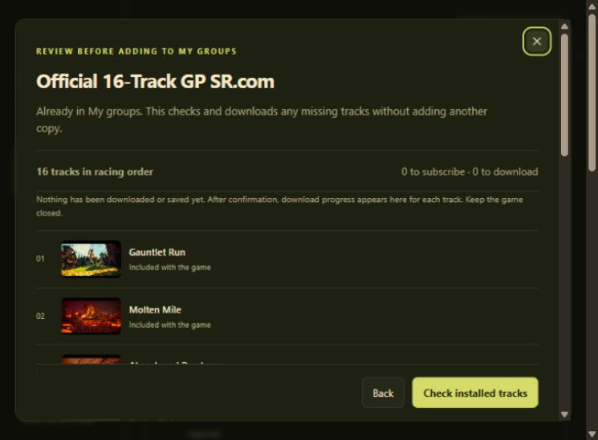
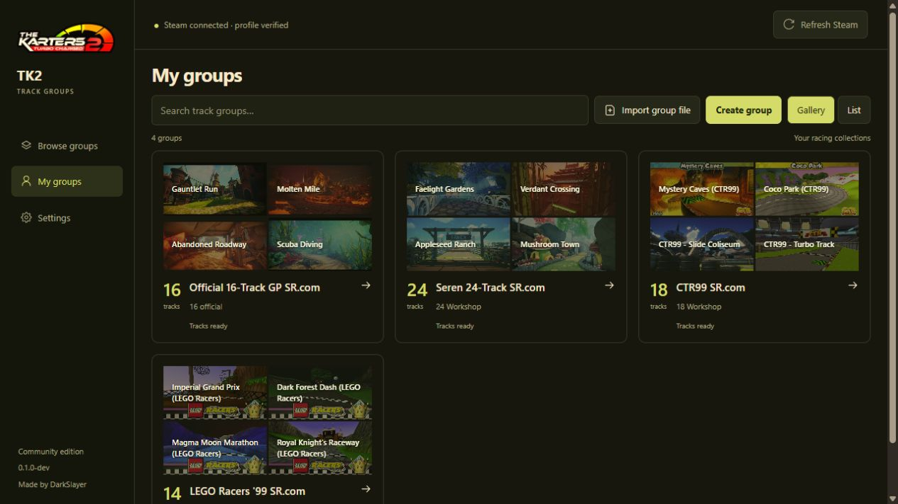
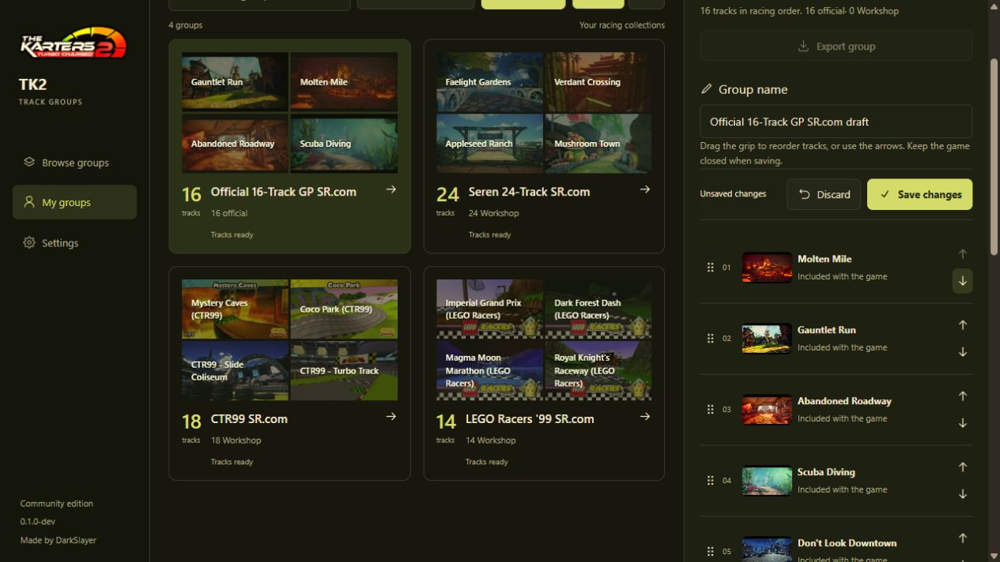
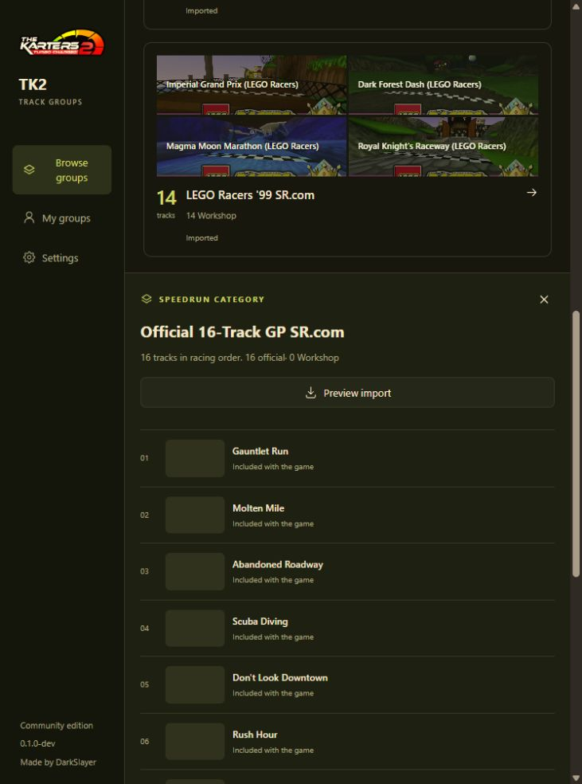

# TK2 Track Groups

A standalone Windows app for sharing ordered track groups in **The Karters 2: Turbo Charged**. Browse a reviewed community library, export custom groups, and import groups with their Steam Workshop subscriptions.

**Development preview: 0.1.0-dev.** Supports game build **0.1.4.18**, Steam app **2269950**. No BepInEx or mod toolkit required. No release has been published.



## Use the app

Portable builds contain the runtime and compiled interface. Extract the ZIP into one chosen folder and run **TK2 Track Groups.exe**. Users do **not** install Python, Node.js, or npm. Requires Windows x64, Microsoft Edge WebView2 Runtime, the installed supported game, and the running Steam client. Steam Cloud must be enabled for imports.

1. Close the game and open the app. In **Settings**, check the detected game folder and profile. If multiple profiles exist, explicitly select the correct one.
2. Steam connects automatically at launch; use **Refresh Steam** to recheck. The app checks the active account, Workshop metadata, and local/Steam save agreement. Resolve any conflict before continuing.
3. In **Browse groups**, choose **Speedrun** for reviewed Speedrun.com collections or **Community** for other curated collections. Select a group and choose **Preview import**. A focused review dialog opens over the library, showing numbered track names, installation status, and any name/order changes. Confirm **Add to My groups** or **Update My groups**. Keep the game closed until completion.
4. Missing Workshop items are subscribed and downloaded automatically. Per-track progress and cancellation stay in the review page; no files are downloaded before confirmation. Completed subscriptions remain if importing fails or is cancelled; the app never unsubscribes content. When saving finishes, **View in My groups** opens the saved collection.
5. Start the game and open Track Groups. Importing the same group again is a no-op; an update preserves its position. A different group ID with the same name becomes a numbered copy.

**My groups** manages your custom groups in the game:

- **Import group file** opens a shared `.tk2group.json` for review. Saving adds it to your game and My groups; it does not publish it to the curated library.
- **Create group** accepts a name and ordered Workshop item IDs or links, separated by lines, spaces or commas. Steam resolves compatible track names before review. Duplicates and unavailable/incompatible items are rejected.
- Switch between **Gallery** (public Workshop preview images with track-name fallbacks) and **List**. Both show missing-track counts after a Steam refresh.
- Select a group to edit its name directly. Drag track grips into racing order (or use the up/down arrows), then **Save changes** in the same panel. Save and Discard fade into a reserved area when something changes, keeping the track list steady. Reordering animates around the dragged track; reduced-motion preferences are respected. The group keeps its position and every native track reference/preset. No subscriptions are changed.
- **Refresh Steam** checks known dependencies even after unsubscribing. **Repair missing tracks** reviews named missing items, then **Download missing tracks** restores subscriptions/downloads without rewriting the group or profile.
- **Export group** shares group data and public metadata, never player progress, account IDs, upload credentials, or track assets. Connect Steam to resolve Workshop dependencies first.





Both Browse groups and My groups offer Gallery and List views, remembered independently. Track previews appear in galleries, group details and import reviews. Steam success messages dismiss after five seconds.

Only reviewed catalog submissions appear in Browse groups. The bundled four collections are under Speedrun; the Community category is ready for future reviewed submissions.

Track identities and public titles/previews are cached in `%LOCALAPPDATA%\TK2 Track Groups\dependencies.json`; subscriptions are always checked against Steam. For an older group whose Workshop IDs were never recorded, import its original `.tk2group.json` to recover and verify the mapping. The game save alone does not contain Steam item IDs, so the app does not guess from a title.



| Bundled group | Official | Workshop |
| --- | ---: | ---: |
| Official 16-Track GP SR.com | 16 | 0 |
| Seren 24-Track SR.com | 0 | 24 |
| CTR99 SR.com | 0 | 18 |
| LEGO Racers '99 SR.com | 0 | 14 |

The saved official group name contains two spaces before `SR.com`; exports preserve it exactly. Official tracks display verified names and bundled previews. Workshop titles come from public Steam metadata. **Refresh library** resolves this repository's public `main` commit, then fetches its catalog and groups from that same revision. The last validated library stays available offline, including when GitHub is unavailable or rate-limited.

## Save safety

Imports modify only the selected custom group in the third profile record. The first two records remain byte-for-byte identical; built-ins, other custom groups, and unrelated fields are preserved. Local and Steam Remote Storage copies must agree before importing. Writes retain a backup, recheck the original, replace the local file atomically, and verify both copies. Steam manages its Cloud upload; the app never edits `remotecache.vdf`.

Preferences, cache, backups, and diagnostics live in `%LOCALAPPDATA%\TK2 Track Groups`. Closing shuts down the server. During an operation, closing requests cancellation and keeps the window open until the worker finishes safely; close again afterward. See [recovery instructions](docs/RECOVERY.md) if recovery needs attention.

## Contributor setup

Use **Python 3.14 x64**, **Node.js 24**, and npm. From the repository root:

```powershell
python -m venv .venv
.venv\Scripts\python.exe -m pip install -r requirements.txt
npm ci
npm run build
.venv\Scripts\python.exe launch.py
```

Alternatively, double-click **Launch Track Groups.cmd** for source setup and launch. These are contributor steps, not portable-user steps.

For UI development, run `python launch.py --no-window`, then `npm run dev` in another terminal. Open `http://127.0.0.1:5173`. Vite reads the local backend session and proxies its authenticated API. Stop both terminals afterward. Python changes require restarting the backend; Vite updates React live.

```powershell
python -m unittest discover -s tests
python tools/check_catalog.py
npm test
npm run format:check
npm run build
python tools/build_portable.py
./tools/smoke_portable.ps1 -PortableFolder ./artifacts/TK2-Track-Groups-0.1.0-dev-win-x64
```

The build creates a portable folder and ZIP under ignored `artifacts/`. It bundles Python and compiled UI assets, excludes developer dependencies, and never bundles `steam_api64.dll`. A dedicated helper loads that DLL from the installed game and uses the existing Steam client; it does not launch a second game instance.

The ZIP contains the executable and its dependencies directly at its root: extract it into one chosen folder. Python bytecode is optimized, unnecessary webview package collection is removed, and ZIP compression uses level 9. The compiled interface is small; most portable size is the Python, HTTPS and Windows webview runtime bridge. Neither `node_modules` nor the contributor environment is shipped.

## App updates and future releases

Startup checks stable releases from [this repository](https://github.com/The-Karters-Community/TK2-trackGroup-tool/releases). **Settings → Check for updates** checks again. A portable app with a newer compatible release shows **Update app**. Source checkouts use Git instead. Updates require a button click, verify the archive SHA-256 and every manifest file, replace the current app, then reopen it. Standard `TK2-Track-Groups-<version>-win-x64` folders are renamed to the new version; custom folder names remain as chosen. A destination collision stops before shutdown. Settings, track identities and save backups remain outside the installation folder. Additional user files are preserved, obsolete app-owned files are removed, and temporary rollback files are removed after the new app passes startup verification. A failed startup restores and reopens the previous app.

No public release exists yet. To make a future release compatible with the updater:

1. Set the same **stable** version in `trackgroups/__init__.py`, `package.json`, and the package lock. Run checks and build from a clean, committed checkout pushed to `main`.
2. Upload both generated files to a matching tag `vX.Y.Z`: `TK2-Track-Groups-X.Y.Z-win-x64.zip` and `TK2-Track-Groups-X.Y.Z-win-x64.zip.sha256`. Keep the generated `portable-manifest.json` inside the ZIP. Draft/prerelease releases are not offered as normal updates.
3. Verify the relocated bundle and updater lifecycle before publishing. `python tools/check_update_lifecycle.py artifacts/TK2-Track-Groups-X.Y.Z-win-x64` compiles an isolated version fixture, tests replacement/rename and failure rollback, and checks shutdown/deletion. It requires Windows and all other app instances to be closed; it changes no saves and publishes nothing.
4. Publish with GitHub CLI, for example `gh release create vX.Y.Z <zip-path> <checksum-path> --title "TK2 Track Groups X.Y.Z" --notes-file <notes-path>`. Only after publishing, advance source to the next `-dev` version. Routine edits do not bump artifact versions.

| Location | Responsibility |
| --- | --- |
| `trackgroups/groups.py`, `profile.py` | Portable format and verified save codec |
| `trackgroups/steam.py`, `worker.py`, `content.py` | Steam helper and content checks |
| `trackgroups/transaction.py` | Backup, writes, verification, recovery |
| `trackgroups/service.py`, `app.py` | State, previews, native window/API |
| `trackgroups/catalog.py`, `catalog/` | Reviewed library and cache |
| `trackgroups/dependencies.py` | Public track identity cache, retained after unsubscribe |
| `trackgroups/updates.py`, `tools/apply_update.ps1` | Verified portable release updates and rollback |
| `ui/src/` | React pages, shared components, one stylesheet |
| `tests/`, `tools/`, `.github/workflows/` | Checks, builds, catalog validation |

See [CONTRIBUTING.md](CONTRIBUTING.md) and [format/evidence notes](docs/FORMAT.md). Tool code is MIT licensed; tracks, the game logo and game content retain their authors' rights. Branding uses the same supplied logo/icon as the community mod toolkit.

See the [verification record](docs/VERIFICATION.md) for completed real-account/game tests and remaining test limits. The portable smoke check requires Steam and the supported game, and must run with this app and the game closed.
