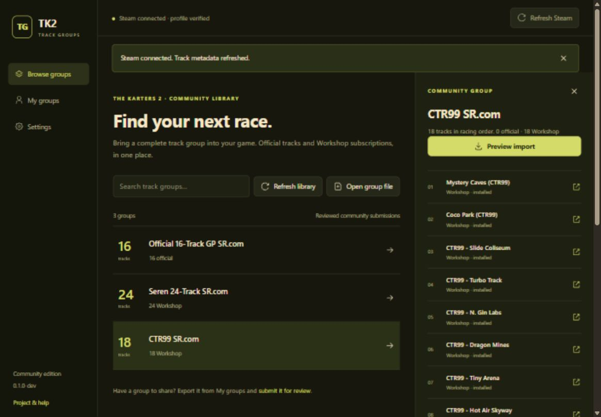

# TK2 Track Groups

A standalone Windows app for sharing ordered track groups in **The Karters 2: Turbo Charged**. Browse a reviewed community library, export custom groups, and import groups with their Steam Workshop subscriptions.

**Development preview: 0.1.0-dev.** Supports game build **0.1.4.18**, Steam app **2269950**. No BepInEx or mod toolkit required. No release has been published.



## Use the app

Portable builds contain the runtime and compiled interface. Extract the entire folder and run **TK2 Track Groups.exe**. Users do **not** install Python, Node.js, or npm. Requires Windows x64, Microsoft Edge WebView2 Runtime, the installed supported game, and the running Steam client. Steam Cloud must be enabled for imports.

1. Close the game and open the app. In **Settings**, check the detected game folder and profile. If multiple profiles exist, explicitly select the correct one.
2. Choose **Connect Steam**. The app checks the active account, Workshop metadata, and local/Steam save agreement. Resolve any conflict before continuing.
3. In **Browse groups**, select a group to inspect its ordered tracks. Choose **Preview import**, review additions or changes, then confirm. Keep the game closed until completion.
4. Missing Workshop items are subscribed and downloaded automatically. Progress and cancellation appear above the library. Completed subscriptions remain if importing fails or is cancelled; the app never unsubscribes content.
5. Start the game and open Track Groups. Importing the same group again is a no-op; an update preserves its position. A different group ID with the same name becomes a numbered copy.

**My groups** lists your custom groups. Connect Steam to resolve Workshop references, then **Export group**. Share the `.tk2group.json` file; recipients use **Open group file**. Exports contain group data and public metadata, never player progress, account IDs, upload credentials, or track assets.

| Bundled group | Official | Workshop |
| --- | ---: | ---: |
| Official 16-Track GP SR.com | 16 | 0 |
| Seren 24-Track SR.com | 0 | 24 |
| CTR99 SR.com | 0 | 18 |

The saved official group name contains two spaces before `SR.com`; exports preserve it exactly. Official tracks currently display their configuration IDs. Workshop titles come from public Steam metadata. **Refresh library** checks this repository's public `main/catalog/`; the last validated library stays available offline.

## Save safety

Imports modify only the selected custom group in the third profile record. The first two records remain byte-for-byte identical; built-ins, other custom groups, and unrelated fields are preserved. Local and Steam Remote Storage copies must agree before importing. Writes retain a backup, recheck the original, replace the local file atomically, and verify both copies. Steam manages its Cloud upload; the app never edits `remotecache.vdf`.

Preferences, cache, backups, and diagnostics live in `%LOCALAPPDATA%\TK2 Track Groups`. Closing shuts down the server. During an operation, closing requests cancellation and keeps the window open until the worker finishes safely; close again afterward. See [recovery instructions](docs/RECOVERY.md) if recovery needs attention.

## Contributor setup

Use **Python 3.14 x64**, **Node.js 24**, and npm. From the repository root:

```powershell
python -m venv .venv
.venv\Scripts\python.exe -m pip install -r requirements.txt
npm ci
npm run build
.venv\Scripts\python.exe launch.py
```

Alternatively, double-click **Launch Track Groups.cmd** for source setup and launch. These are contributor steps, not portable-user steps.

For UI development, run `python launch.py --no-window`, then `npm run dev` in another terminal. Open `http://127.0.0.1:5173`. Vite reads the local backend session and proxies its authenticated API. Stop both terminals afterward. Python changes require restarting the backend; Vite updates React live.

```powershell
python -m unittest discover -s tests
python tools/check_catalog.py
npm test
npm run format:check
npm run build
python tools/build_portable.py
```

The build creates a portable folder and ZIP under ignored `artifacts/`. It bundles Python and compiled UI assets, excludes developer dependencies, and never bundles `steam_api64.dll`. A dedicated helper loads that DLL from the installed game and uses the existing Steam client; it does not launch a second game instance.

| Location | Responsibility |
| --- | --- |
| `trackgroups/groups.py`, `profile.py` | Portable format and verified save codec |
| `trackgroups/steam.py`, `worker.py`, `content.py` | Steam helper and content checks |
| `trackgroups/transaction.py` | Backup, writes, verification, recovery |
| `trackgroups/service.py`, `app.py` | State, previews, native window/API |
| `trackgroups/catalog.py`, `catalog/` | Reviewed library and cache |
| `ui/src/` | React pages, shared components, one stylesheet |
| `tests/`, `tools/`, `.github/workflows/` | Checks, builds, catalog validation |

See [CONTRIBUTING.md](CONTRIBUTING.md) and [format/evidence notes](docs/FORMAT.md). Tool code is MIT licensed; tracks and game content retain their authors' rights.
