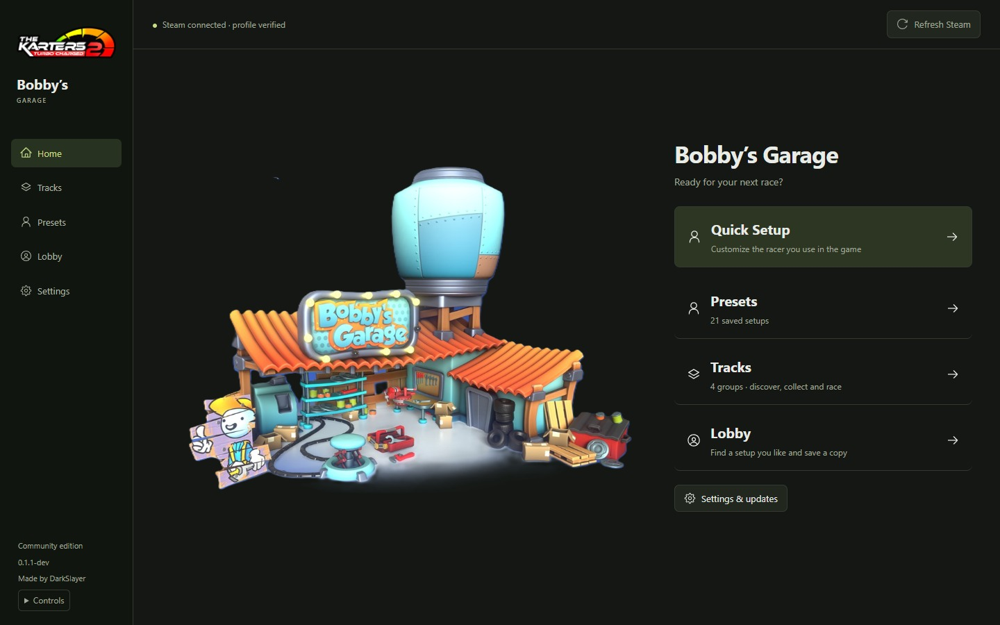
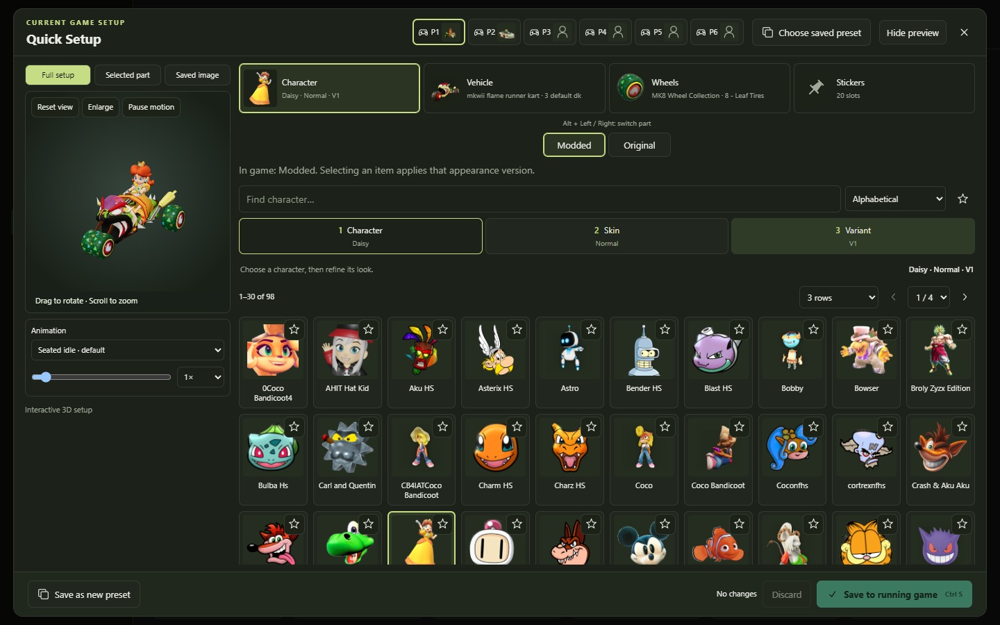
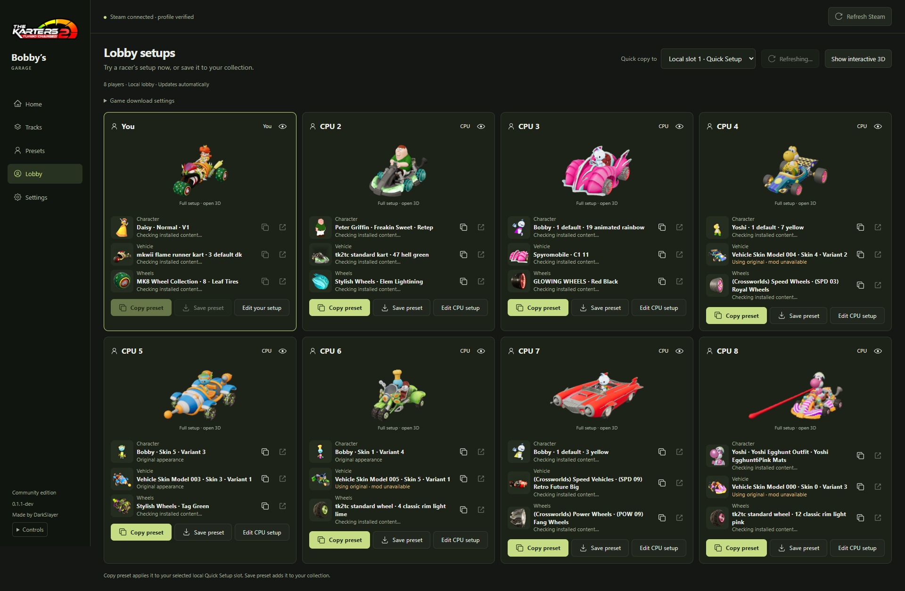
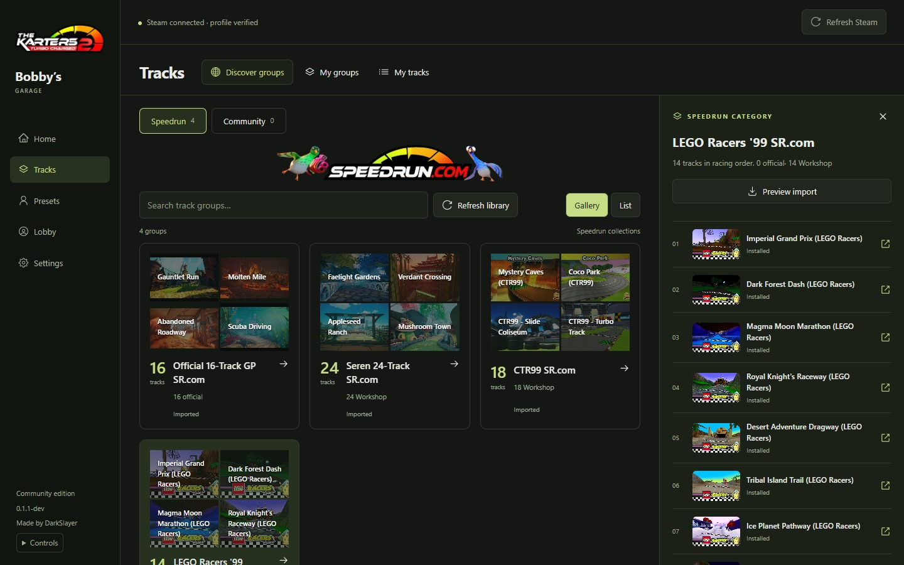

# Bobby’s Garage

Your pit stop for **The Karters 2: Turbo Charged**. Customize racers, collect
presets and organize tracks for your next race.

[Download for Windows](https://github.com/The-Karters-Community/TK2-trackGroup-tool/releases/latest) · [Open browser edition](https://the-karters-community.github.io/TK2-trackGroup-tool/) · [What’s new](CHANGELOG.md)

> **Version 0.1.2** fixes downloaded-app startup and live Quick Setup game detection.

## Build your next racer

- **Quick Setup:** customize up to six saved local slots, with the game open or closed.
- **Presets:** save favorite looks, arrange collections, and import or export setups.
- **3D preview:** rotate, zoom, inspect individual parts and try character animations.
- **Favorites:** star an exact look on its tile and find it again quickly.
- **Lobby:** browse racers during a lobby or race, copy their look to your Quick
  Setup, or save it to your collection. Editable CPUs have their own controls.

### Play with a controller or keyboard

Keep Garage focused and press a controller button to connect.

| Action | Controller | Keyboard |
| --- | --- | --- |
| Browse choices | D-pad / left stick | Arrow keys |
| Choose | A | Enter / Space |
| Character / Vehicle / Wheels / Stickers | LB / RB | Alt + Left / Right |
| Change page | LT / RT | Page Up / Page Down |
| Back | B | Esc |
| Save editor changes | Menu / Start | Ctrl + S |

Tab reaches individual controls, including favorites. Open **Controls** in the
sidebar for help. Controller support requires a browser/WebView with the standard
Gamepad API; other apps must give focus back to Garage first.

## Find a look in the lobby

Browse up to eight racers in a four-column gallery, including during a race.
Copy a setup to your Quick Setup or save it to your collection.

## Keep your tracks together

**Tracks** brings Discover groups, My groups and My tracks into one place.
Import a curated Speedrun collection, select installed tracks to make a group,
then drag them into racing order. Share your own groups as portable files.

## Get started

1. Extract the Windows ZIP into a folder and open **TK2 Track Groups.exe**.
2. Keep Steam running. In **Settings**, check the game folder and selected profile.
3. Open **Quick Setup**, **Presets**, **Tracks** or **Lobby** from Home.

Windows x64 and Microsoft Edge WebView2 are required. Portable users don’t need
Python or Node.js. Saving checks your local and Steam copies and keeps recovery
backups; Steam Cloud must be enabled for desktop save operations.

If version 0.1.1 fails with `Failed to resolve Python.Runtime.Loader.Initialize`,
download version 0.1.2 or newer and extract it into a new folder. The release
includes the .NET configuration needed for Internet-marked dependencies.

The desktop reads installed game and Workshop content. Subscribe to the cosmetics
you want to use in Steam. Matching pictures are cached locally, and new Workshop
content refreshes automatically. Lobby pictures reuse a bounded local cache;
a new setup needs its first render.

The **browser edition** edits a save you choose locally. It cannot connect to
Steam, decode 3D assets or edit a running game. Follow the
[browser instructions](docs/WEB.md) when applying its downloaded save.

## Help and development

[Presets & Quick Setup](docs/PRESETS.md) · [Lobby](docs/LOBBY.md) · [Recovery](docs/RECOVERY.md) · [Contributing & source setup](CONTRIBUTING.md)

Compatible game patches are detected at runtime, with no patch-number allowlist.
Changes to game APIs or asset formats can still need an update. See
[compatibility notes](docs/NATIVE-BRIDGE-RESEARCH.md) and
[report a bug](https://github.com/The-Karters-Community/TK2-trackGroup-tool/issues)
with the game and Garage versions.

Development builds and release changes are recorded in [CHANGELOG.md](CHANGELOG.md).
Source builds use Python 3.14 x64, Node.js 24 and npm. Executable names and the
local data folder retain “TK2 Track Groups” for existing installs and updates.

Code is MIT licensed. Game and Workshop content belong to their authors and are
not included in portable exports. Garage artwork supplied by DarkSlayer.
