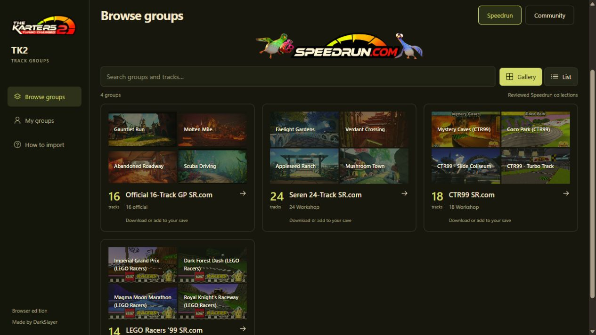

# Browser edition

Use [TK2 Track Groups online](https://the-karters-community.github.io/TK2-trackGroup-tool/). No executable, account login, Node.js or local server is required. The website supports the verified **0.1.4.18** save format.



## What works

- Browse the reviewed Speedrun and Community catalog in Gallery or List layout; search names and tracks. Currently the four bundled collections are Speedrun groups.
- Read ordered track names/previews and open Workshop subscription pages.
- Download or open a portable `.tk2group.json` file.
- Select a local game save, inspect its custom groups, rename/reorder them, and prepare an edited save download.
- Update a matching stable group ID. If the same name has a different ID, explicitly select the existing group or add a numbered copy. Updates preserve its position and local ID.

All profile processing stays in browser memory. No profiles, account IDs or edits are uploaded or stored in browser storage. Refreshing/closing the tab discards edits not downloaded. The production Content Security Policy prohibits fetch/XHR/WebSocket connections and form submissions. Static site requests go to GitHub Pages; public Workshop thumbnail requests go to Steam image hosts. The browser edition has no Python/Steam helper or desktop API.

## Apply an edited save

**Presets:** open a save, then choose Presets in navigation. Export selections or
groups, import `.tk2presets.json`, edit original/modded configurations, membership
and order. These changes use the same backup/download controls and Cloud workflow
below. Cosmetic asset installation is unverified; the website cannot inspect local
Mods or subscribe cosmetic Workshop items. See [preset limitations](PRESETS.md).

1. Close the game and let Steam finish syncing. Disable Steam Cloud **for this game** in Steam Library → game Properties → General. Keep it disabled throughout the import and first verification.
2. Choose **Open game save**. Your local folder is `%USERPROFILE%\AppData\LocalLow\PixelEdgeGames\TheKarters2`; select the correct `<Steam ID>PTK_PlayerData_v19tpp0_bt0` file. The browser cannot determine which Steam account is active. Do not choose Steam's userdata/cache files or a backup extension.
3. Select a library group and review the change, or open a shared group file in **My groups**. Confirm replacement explicitly when updating. Existing name/order changes use the inline editor and Save changes; these affect only the browser copy.
4. For Workshop tracks, use each Steam link to subscribe through your Steam account. Let Steam finish downloading. The website cannot query subscriptions, validate downloaded track content or detect deleted/private items. Unknown Workshop identifiers remain intact in existing groups but cannot be exported without a resolved group file.
5. Download the original backup, acknowledge that the game is closed and its Cloud setting is disabled, then download the edited save. These checkboxes are user confirmations, not machine checks.
6. Manually replace the original LocalLow save with the edited download. Keep the **exact original filename**, removing a browser-added suffix such as `(1)`. Keep the backup elsewhere. Never modify `remotecache.vdf`.
7. Start the game with Cloud still disabled. Verify group name, count, order and playable Workshop tracks, then exit normally. Keep Cloud disabled until the local result is verified. Re-enabling it can cause a sync conflict or overwrite edits; the website cannot reconcile the cloud copy.

To undo, close the game, keep Cloud disabled, and restore the original backup under its exact original filename. This workflow deliberately downloads files instead of directly overwriting them; it works across mainstream browsers without granting folder permissions.

### Why Cloud must be disabled here

Native evidence for `PlatformSpecific_Steam.LoadCloudSaveData_Impl` at **0x1809f0a20** checks `SteamRemoteStorage.IsCloudEnabledForAccount` and `IsCloudEnabledForApp`. When either is false, it calls `PlatformSpecificBase.LoadDataLocally`. With both true, it reads Steam Remote Storage first. Editing only LocalLow with Cloud enabled can therefore be ineffective.

`SaveCloudSaveData_Impl` at **0x1809f1bd0** calls FileWriteAsync and refreshes the LocalLow file; disabling sync is not a promise that the game's own Steam API calls stop. A browser cannot invoke these APIs, verify cloud agreement or establish server upload completion. The desktop app's Remote Storage transaction remains the automatic path. See [format evidence](FORMAT.md) and [Steam Remote Storage documentation](https://partner.steamgames.com/doc/api/ISteamRemoteStorage).

These findings come from approximate native pseudocode, not original C# source. Real-save codec parity and browser downloads are verified; a full Cloud-disabled browser-to-game import has **not yet been exercised live**. Do not mistake the desktop app's earlier live import tests for browser-workflow coverage.

## Contributor development and deployment

The existing npm installation is shared with the desktop frontend; no second package or node_modules tree is added.

```powershell
npm ci
npm run dev:web
# http://127.0.0.1:5174/TK2-trackGroup-tool/
npm test
npm run build:web
python tools/check_web_build.py
```

Web mode chooses `ui/src/web/WebApp.jsx`, skips desktop session discovery/proxying, uses `/TK2-trackGroup-tool/` as its asset base, and writes ignored `ui/web-dist/`. Desktop `npm run build` still writes `ui/dist/` and uses its authenticated local backend. Both editions reuse the track/gallery/editor components and the single stylesheet.

`ui/src/web/profile.js` owns format validation and save transformations. Track-group operations retain the first two binary records exactly; explicit preset edits can update the first. It uses lossless-json to preserve unrelated 64-bit integers and decimal tokens. `catalog.js` imports only reviewed group data and allowlisted public thumbnail URLs. File inputs/downloads, review UI and import instructions are separated from the codec.

In Presets, **Add preset images** opens a local folder picker. Choose
`%USERPROFILE%\AppData\LocalLow\PixelEdgeGames\TheKarters2\PresetIcons` for both
Original and Modded renders. PNGs stay in the tab and are not uploaded or bundled
into exports. The browser cannot inspect installed cosmetic bundles for names;
it uses pictured setup numbers and saved-choice labels instead. Network requests
remain prohibited by the production CSP. Dragging stages an order locally;
**Save changes** applies it to the in-memory save before the usual download flow.

The Pages workflow runs frontend tests, formatting, catalog validation and the static-bundle check, then deploys **only** `ui/web-dist`. Repository Pages must use GitHub Actions as its source. Pushes to `main` affecting the website/catalog redeploy it; no desktop release or version bump is required. Visitors reload to get the latest catalog and interface. No service worker retains stale copies.

Adding a catalog group follows [CONTRIBUTING.md](../CONTRIBUTING.md). `catalog/track-previews.json` may contain only public Steam image URLs keyed by reviewed item IDs; it contains no profile/cache records or account information. Track art retains its authors' rights.
